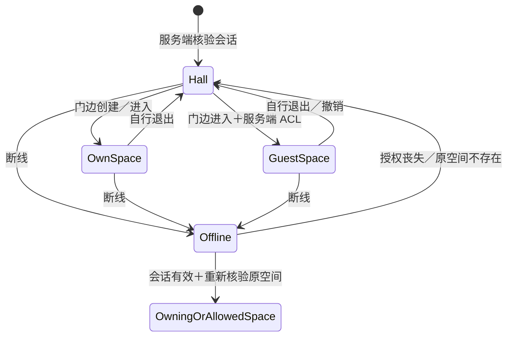

# RFC：西木会馆多人生活与「虹之间」（#100）

**状态：馆长已于 2026-11-28 审定下文三项建议（见文末审定记录），#101 按此实现。** 本 RFC 梳理已落地行为和取舍；审定只覆盖虚构账户的试点，不改变生产配置、旧码迁移或正式策略。

## 空间和归属

| 层 | 当前契约与权威 | 明确不包括 |
| --- | --- | --- |
| 公共会馆 | LAB 的公共 hall；会馆内已认证玩家同场互动，位置、物件和广播由网关按空间授权 | 不是任何一个玩家的私有存档 |
| 私人灵质空间 | 由玩家在「虹之间」入口创建，私有行的 owner 是服务端 LAB pid，访问表按空间与 pid；R4 独立演化是可用边界，须单独核验选定版本与运行环境的分支配置 | 不把宿主权授予访客；不因为换视角复制世界 |
| 「虹之间」共享 | 是通向受邀私人空间的入口与访问授权，不是另外一套账户或额外公共地图 | 访客不取得所有权、邀请权限或分支时钟控制 |
| Account / OC | 会馆账户 owner 为 `(kind, uid)`，只由会馆认证会话解析；已合入的可选 LAB 发行端给网关不透明 `sub` 与短时授权，不把账户库或 cookie 给 LAB。OC 原作者及角色存档归属按原系统判定，LAB 自用展示图并非角色所有权凭证 | 昵称、客户端消息中的 uid、OC 缩略图、独立测试码都不是会馆 Account 证明 |
| LAB 玩家记录 | 网关由有效 LAB 会话解析内部 code_id，再查稳定 pid；可选绑定须证明旧会话及会馆授权，按允许名单复用原 pid，不能把两个已存在玩家存档自动合并 | 不把别的游戏或全站访客进度归并到此记录 |

Portal/Hall 提供导航、浏览器账号确认与会馆会话；Godot Web/原生只做输入和 2D/3D 展现；LAB 网关负责鉴权、ACL、权威位置和 SQLite 持久化；R4 若启用，只处理项目选定的生态、时钟及分支。源码、导出包和测试脚本归仓库；运行数据、运营凭证、部署域名、临时会话和资料不进源库。Portal 跳转并不等于上线或授权。

## 生命周期与线上协议

| 功能 | 已有协议 | 提案／边界 |
| --- | --- | --- |
| 公共同场、在线状态、互动 | `hello/welcome`、`join/leave`、`move/s/correct`、`emote`、`chat`、`interact/object`，同房才有玩家事件与 OC 展示授权 | 同场名单不是全站在线状态。好友名单、跨房在线发现与私信不是现有功能，建议不纳入首轮 |
| 创建与访问 | `space_create`、`spaces`、`space_enter`；服务端校验房间、入口距离、所有权或 ACL，不把收到目标 ID 当作授权 | 建议首轮仅一主空间与受邀访问，不实现访客装修/编辑/管理 |
| 邀请、拒绝、撤销 | #101 起：`space_invite` 只写待确认邀请（`space_invites`，7 天过期），通知来客 `invited` / `invites`；来客 `space_invite_accept` 后才写 ACL，`space_invite_decline` 删除邀请。`space_revoke` 同时删 ACL 与待确认邀请，在线在场访客返回 hall 出生点，离线重连时复验 | 重复邀请幂等；过期后可重新邀请；已接受的访客不自动过期。审定前的旧 ACL 行视为已接受 |
| 时钟与恢复 | `space_time` 的暂停/推进仅 owner 且需要有效 R4 分支（依实际构建/配置）；网络 `kicked:replaced` 和重连时复验房间 | 失去房间访问时建议返回公共出生点，不复用旧私人坐标；正式双端验证前覆盖双会话竞争及断线时撤销 |

已实现流程（#101）：`未授权 → 待确认 → 接受后可进入；拒绝／过期 → 未授权；owner 撤销 → 未授权并退出`。待确认邀请 7 天过期（`INVITE_TTL`），过期后 owner 可再次邀请；已获准的来客不设自动过期。旧流程「发邀请即授予」已停用。

## 威胁、成本和最小闭环

- **冒用/越权**：会话与空间权限由服务端获取并校验，不信任客户端身份；房间仅向授权者列出或广播，原件不从跨房游戏 API 导出。只允许服务端认证身份与现有账号关联，不用昵称推断；合成账号不触碰真实库。
- **撤销／竞态**：加入、重连和房间写入端检查空间权利。测试同 pid 的替换与并发连接、离线撤销后回到公共空间、不能读取或改写另一空间的物件、聊天、OC 和时钟。一旦保存空间失权，公共回退不携带私人空间坐标。
- **成本**：位置广播每秒约 10 批、按空间隔离；空间增长带来 ACL/准备状态、SQLite 备份、审计日志、R4 分支/时钟与临时 OC 展示缓存的成本。首轮只需一个本机网关、两个虚构身份和临时数据库；R4 可关闭（记录不能证明 R4 隔离），不新增后台或生产依赖。
- **分阶段**：先冻结权限语义和概念边界；#101 用 mock transport/契约测试覆盖双方移动/表情、两房隔离、邀请/拒绝/撤销、重连与持久归属。通过后可加 WebSocket 本机复核，以及 Godot 同场表现、资源采样和保存日志；真实外网、R4 和性能上限不是这轮验收。

## 请馆长审定

1. 首轮邀请是否明确要求「接受／拒绝」并在接受前不授予访问？如果用现状的「可不进入」，请明确批准将其当作 #101 允许的替代，而不是把它写成已有拒绝按钮。
2. 是否采用「同场可见，首轮不做全站好友／在线可见；访客只互动，不管理、布置或改时间」？如有例外请列允许的动作。
3. 未接受邀请的期限和续邀、访客失权后返回公共出生点是否按上文？试点仅虚构账户，不改变旧码迁移和正式策略。

审定记录：**2026-11-28 馆长审定**：① 采用「接受后才授权」，拒绝或过期不授权；② 首轮只做同场可见，不做全站好友/在线；访客只能互动，不能管理、布置（铺路、种植）或调整时间；③ 待确认邀请可过期并可续邀，已接受访客不自动过期，失权后回到公共会馆出生点。仅适用于虚构账户试点。参考：[现有协议](ARCHITECTURE.md)、[现有回归记录](TEST-REPORT.md)、[可选账号关联](../LAB-ACCOUNT-BRIDGE.md)、[身份和存档语义](../../../docs/zszm-identity-and-save-map.md)。
