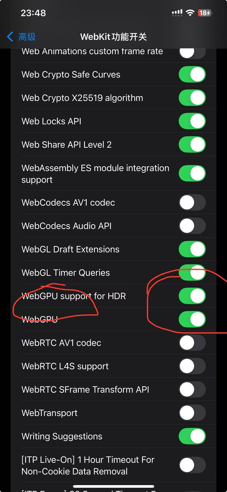

# softie · 软乎乎。

<p align="center">
  
</p>

[](LICENSE)
[](https://softie.520ai.site)
[](https://www.w3.org/TR/webgpu/)
[](https://threejs.org)
[](https://github.com/yuanyang749/softie-webgpu/stargazers)

一个基于原生 WebGPU 的 3D 软体物理项目。统一入口默认呈现灵体互动体验；原 softie 软体物理、表情与凝胶材质作为灵体的可替换技术底座。

灵体互动：[https://spirit.iridescently.xyz/games/spirit-playground?room=forest](https://spirit.iridescently.xyz/games/spirit-playground?room=forest) · 创建灵体：[/games/spirit-playground/create](https://spirit.iridescently.xyz/games/spirit-playground/create) · 管理员调试：[/games/spirit-playground/debug](https://spirit.iridescently.xyz/games/spirit-playground/debug)

---

## 核心功能

### 1. 软乎乎史莱姆（解压桌面玩具）

- **自由揉捏交互**：按住局部凹陷、拖动拎起拉伸、松手回弹；支持移动端双指捏合拉伸（Pinch-to-stretch）以及点击/空格「戳一下」。
- **打工趣味装扮**：支持自由佩戴打工人工牌、续命冰美式咖啡、战损创可贴等趣味装扮，配件随软体表面实时动态形变。
- **打工怨气槽 HUD**：磨砂玻璃风格的状态指示，实时反映打工情绪（摸鱼放空、有点暴躁、惊醒等），随揉捏戳戳动态化解。
- **外观与手感定制**：预设草莓、薄荷、葡萄三种经典果冻色，支持自定义取色器；软硬度（糯叽叽 / 有弹性）与阻尼（晃悠悠 / 很乖巧）自由调节。
- **灵动表情与视线**：眼睛随鼠标和视线自然跟随，拥有眯眼、微笑、惊讶等多种动态情绪表情和自然眨眼。
- **音效与触感**：内置清脆解压音效，支持全局音量无级调节与一键静音。

### 2. 灵体试验场

独立入口 `/games/spirit-playground`，线上地址为 [spirit.iridescently.xyz](https://spirit.iridescently.xyz/games/spirit-playground?room=forest)。公开页只呈现灵体互动场景；点击自己的灵体会戳一下，点击空地会走过去，点击同伴会靠近到接触距离并停下。支持 WASD、灵体间推挤、单指拖拽与双指拉伸，房间服务器负责权威状态。

- `/games/spirit-playground/create` 是精简的灵体创建页，调节颜色、大小、软硬、阻尼、透明度、形态和昵称；未创建云端档案时默认使用项目账户昵称。
- `/games/spirit-playground/debug` 保留联机、参数与状态诊断，只对管理员开放。
- 柔团灵使用原 softie 的物理形变、面部和半透明凝胶高光，不再用纯色平涂占位。软体核心基于开源项目 [softie-webgpu](https://github.com/yuanyang749/softie-webgpu)，感谢 Yuanyang749。
- 切换柔团灵/耳尾灵，并调节耳部、尾部和眼睛比例；配置在房间中原位同步。
- 新增身体轮廓绘制与实心涂抹；生成的最大连续区域简化为 40 点标准化 `BodyShape`，由现有 softie 网格和物理形变驱动。身体形状与外观一起保存，不保存运行时物理状态。
- 登录项目账号后，灵体外观参数按账号保存到会馆云存档独立 `softie` 范围；游客可在本机保存，支持 JSON 导入导出。
- 离开场景停止渲染和输入，首页状态保留。
- WebSocket JSON 房间按 30 Hz 调度，物理按 120 Hz 子步运行；服务端每秒报告流量、缓冲和 tick 统计。

### 3. 多端适配与国际化

- **双端响应式设计**：专为桌面端与移动端优化布局，触控区域舒适友好，无多余页面滚动。
- **中英双语支持**：右上角一键无缝切换中 / 英文，状态实时记忆，切换无需重新加载。

---

## 📱 iOS Safari 开启 WebGPU 指引

目前 iOS 系统的 WebGPU 处于实验性阶段（内置于 WebKit），在 iPhone / iPad Safari 浏览器中体验前需手动开启开关：

1. 打开系统 **「设置 (Settings)」** ➔ 往下滑动找到并进入 **「Safari 浏览器」**；
2. 滑动到最底部，点击进入 **「高级 (Advanced)」** ➔ 点击 **「WebKit 功能开关 (Feature Flags)」**；
3. 在列表中找到 **`WebGPU`** 以及 **`WebGPU support for HDR`**，将开关切换为**开启（绿色）**；
4. 返回 Safari 重新刷新网页，即可在手机端享受丝滑的 3D 软体捏捏乐！

<p align="center">
  
</p>

---

## 快速运行

```sh
npm install
npm run dev
```

本地打开 `http://127.0.0.1:5173`。

生产构建与预览：

```sh
npm run build
npm run preview
```

预览地址 `http://127.0.0.1:4173`。`dist` 目录可直接作为静态站点部署（线上环境需要 HTTPS 启用 WebGPU 支持）。

## 测试与验证

### 灵体试验场

访问 `/games/spirit-playground`，点击空地前往，点自己的灵体戳一下，点同伴靠近并贴住；桌面端也可用 WASD。按住灵体局部揉捏，拖动搬动或拎起，松手回弹。输入、失焦、切页和断线都会清除控制。

右侧参数即时预览，点击「保存参数」由现有 Vite 服务的 `GET/PUT /api/spirit-settings` 保存到 统一外置存储的 `data/spirit/spirit-settings.json`（Git 忽略）。后台校验版本、字段和范围并原子写入；仅本机可访问，不另开服务。JSON 导入后预览，需点击保存才持久化。静态部署没有此本地 API，可使用导入导出。

`SpiritInstance` 持有独立物理与可替换皮肤。皮肤工厂接收 `{ physics, appearance, environment }`，返回 `root / pickMeshes / metrics / applyAppearance / update / dispose`；柔团灵使用 softie 的软体形变与凝胶材质，耳尾灵和芽灵复用同一形变场。每个场景按需创建并在非活动路由暂停渲染。

既有本地服务可通过 `TEST_URL` 指定，浏览器验证不启动服务器：

```powershell
$env:TEST_URL = 'http://127.0.0.1:5180'
npm run test:spirit
npm run test:account-profile
$env:LOAD_MAX_ROOMS = '10'; npm run test:load-smoke
```

`test:load-smoke` 用 WebSocket 客户端分阶段压测房间服务器（不启动 3D 渲染）；默认最多检查 64 个房间、每房 10 个灵体，调度跌破 27 Hz 时提前停止。`test:account-profile` 模拟项目账号读取和保存云端灵体档案。`test:spirit-experience` 用两个真实浏览器验收页面切换、远端靠近停止、WASD 输入与失焦清理。

```sh
npm test                  # 运行单元测试
npm run test:browser      # 运行浏览器自动化测试
```

## License

Released under the [MIT License](LICENSE).

---

## 在统一工作区中的位置

> 本仓库位于统一工作区 `apps/softie/`。总览见 [根 README](../../README.md)，架构/数据库/API 见 [docs/](../../docs/)。

- 运行：`npm run dev`（5173）/ `npm run preview`（4173，统一入口 softie API 上游）。
- 构建挂载：Vite base `/app/modules/softie/`；入口 `src/app.js` 导出 `mount(container)/unmount`，被统一壳无 iframe 挂载。
- 存档：设置 `spirit-settings.json`（Vite 中间件 `/api/spirit-settings`）；语言/音效偏好 → 统一存档 `m:softie:*`。
- 测试：`npm test`。
