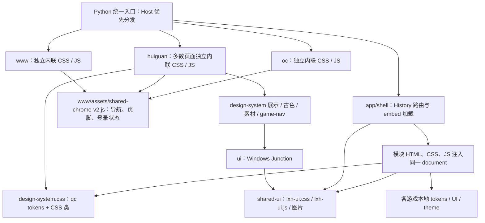
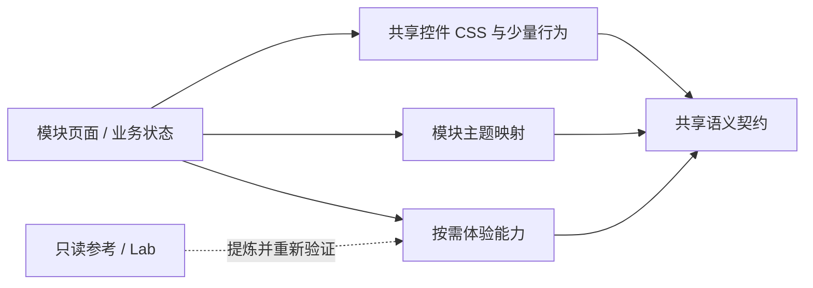

# Iridescently Design System v2 Audit & Architecture Proposal

审计日期：2026-10-04。状态：供评审的方案，尚未实施。

**建议建立“共享基础与交互契约 + 模块拥有的主题和版式 + 按需加载的体验能力”。不把会馆皮肤升级成全站皮肤，不把全部页面迁入 React，也不把五个概念层拆成五个软件包。**

现状不是一个已被全站消费的设计系统，而是两套用途不同的 UI 代码、多个页面自己的设计规则，以及独立注入的公共导航。共同 DNA 应来自内容优先、可读性、状态连续性和交互纪律；页面人格由内容、主题和编排决定。

## 1. 证据范围与判断边界

完整读取了用户 brief、[设计参考基线](<E:/External Projects/Iridescently Labs/research/REFERENCE_BASELINE.md>)，阅读指定的 [web-design-engineer 方法](<E:/External Projects/Iridescently Labs/references/skills/garden-skills/skills/web-design-engineer/SKILL.md>) 及 redesign/critique 相关参考。按 Ponytail full 原则做架构取舍：先确认实际依赖，再决定什么值得共享。

本轮模式是 **Redesign · Overhaul 的方案阶段**：可以推翻视觉架构，但保留业务、数据和路由契约。方法参考里的样式配方、固定颜色数量、英文标题倍数和交付 HTML 的默认流程不直接套用本项目；用户本轮要求的审计报告优先。

已检查根 README、AGENTS、workspace 配置、shared README、架构文档、两套 UI 文件、三个 portal 的 HTML 接入、共享导航、会馆画廊及海报的关键调用链、统一壳、后端静态分发、游戏消费者和七个本地参考的相关实现。没有扫描大型图片库、数据库内容和所有游戏业务代码。

定量口径：三个 portal 根目录的 HTML，加会馆海报页，共 **16 个业务页面**；不含 design-system 展示页和 activation-core。静态搜索显示，仅 account、security、haibao 三页直接引入 `design-system.css`。这是接入覆盖统计，不是视觉质量评分；没有引入 CSS 不等于该页完全没有复用思想。

浏览器补充观察：本地静态服务器上的主站宽屏、窄屏和 OC 窄屏。主站宽屏截图为 1440×1000，窄屏输出为 390×844；浏览器缩放导致某次 `innerWidth` 为 355，故这些是视觉取样，不是精确设备验收。页面仍加载线上共享导航脚本，不能据此声称运行结果完全来自本地源码。静态预览的 SSO API/favicon 出现 404，不列为生产故障。未登录、未提交表单、未做游戏性能测试。

可复查截图：[主站宽屏](../docs/design-system-v2-audit-assets/www-wide.png)、[主站窄屏](../docs/design-system-v2-audit-assets/www-narrow.png)、[OC 窄屏](../docs/design-system-v2-audit-assets/oc-narrow.png)。以下“视觉观察”只适用于这些样本，其他视觉问题由源码推出，仍需正式页面验收。

## 2. A — 真实结构，而非文档中的结构

图中的消费是部分消费：不是每个会馆页面都使用 qc，也不是每个游戏都使用 lxh。主站、会馆和 OC 是不同文档/域名；只有统一游戏壳内部走同文档 embed。整个站群并不是一个单 SPA。

### 2.1 Source of truth 分裂在哪里

| 范围 | 真正控制实现的文件 | 判断 |
|---|---|---|
| 会馆基础控件 | [design-system.css](../portal/huiguan/design-system/design-system.css:8) | 34 个 `--qc-*` 定义，主题、字号、间距、外观同文件；是早期 CSS kit |
| 游戏画风与展示工厂 | [lxh-ui.css](../shared/shared-ui/lxh-ui.css:20)、[lxh-ui.js](../shared/shared-ui/lxh-ui.js:375) | 28 个 `--lxh-*` 定义，加 `window.LXHUI`；偏 HUD、人物面板、徽章、五行图，不是通用站点基础库 |
| 大多数实际页面 | [www](../portal/www/index.html:20)、[OC](../portal/oc/index.html:19)、[会馆首页](../portal/huiguan/index.html:22) | 页面自己的 CSS 和运行时写入的变量，才是最终外观的权威 |
| 站群公共外框 | [shared-chrome-v2.js](../portal/www/assets/shared-chrome-v2.js:25) | 硬编码注入 CSS、导航数据和布局修补；独立于 qc/lxh |
| 游戏导航 | [game-nav.js](../portal/huiguan/design-system/game-nav.js:8)、[portal.json](../server/app/portal.json) | 两种消费机制和数据来源，不能把 README 的“唯一导航数据源”理解成全站已统一 |

`portal/huiguan/design-system/ui` 的实际 `LinkType=Junction`，目标为 `shared\shared-ui`。所以**不是两个路径各维护一份 lxh**；真正并行的是 qc、lxh、页面局部规则及导航样式。把 junction 删除、把目录合并，并不能消除这个问题。

[设计系统文档](../portal/huiguan/design-system/design-system.md:3) 声称入口是会馆 CSS；[shared README](../shared/README.md:5) 声称 shared-ui 是真身。二者分别描述一部分事实。shared README 还保留 shared-types 是独立仓库的说法，与根 README 冲突。v2 要修正职责和消费说明，不再用“真身”掩盖多种用途。

### 2.2 优先处理的架构债

**高优先级：作用域和生命周期先于统一换肤。**

- [壳的 mountEmbed](../server/app/shell/index.html:124) 把模块 head 中的样式追加到公共 head；[render](../server/app/shell/index.html:179) 只调用模块 disposer，没有记录并移除这些注入样式。模块切换会留下样式节点，这是代码可确认的行为；具体污染结果尚未运行复现。
- 游戏存在 `:root`、`body`、`*` 等规则。例如 [cards game.css](../server/app/src/cards/src/game/game.css:1)，甚至 reduced-motion 规则也是全局 `*`。共享 document 意味着模块颜色、滚动和动效规则可能影响壳及后续模块。
- 壳只加载 lxh CSS，却在 [自身样式](../server/app/shell/index.html:10) 使用 `--qc-*` 加字面量 fallback。这不是实际消费 qc token，而是靠 fallback 工作；后续模块若引入 qc，会改变变量解析结果。
- embed 的异步加载没有路由代次保护；快速切换时，旧请求可能继续注入样式/执行模块。v2 动效不能建立在“卸载已保证零泄漏”的假设上。应由壳持有当前挂载的资源记录、取消/过期检查及 disposer，而不是让基础 UI 库接管全站路由。
- [Host 路由](../server/portal_server.py:160) 在 `/shared/` 判断之前返回会馆和 OC Handler；[OC Handler](../portal/oc/server.py:20) 只额外处理 SSO API。**不能假设在任何子域写 `/shared/shared-ui/...` 都能访问共享目录。**第一刀可利用会馆现有 `/design-system/ui/` 联接；跨子域推广前要提供明确静态资源映射并测试 MIME/缓存，不靠复制 CSS。
- [shared-chrome 的布局推断](../portal/www/assets/shared-chrome-v2.js:111) 从 body 子节点里挑最高者插入页脚；[海报页](../portal/huiguan/haibao/index.html:1909) 又轮询修正页脚位置和导航高度。这是隐式布局契约导致的反复修补，应改成显式宿主插槽。

### 2.3 Token、视觉、文字和状态

| 发现 | 证据与影响 | 处置 |
|---|---|---|
| 主题和语义混合 | `--qc-gold` 同时用于文字、主按钮、边框、身份强调；`--lxh-yes` 直接把“是”绑定赭金 | 分离 action、on-action、status、decorative；不把颜色名称当交互意图 |
| 派生颜色不真正派生 | qc accent 与 accent-glow 是分别写死的 hex/rgba | 主题必须一起维护可检验的配对；不认为改 accent 就完成换肤 |
| 文本对比不足 | qc 白字/松绿约 **3.124:1**，白字/金色 **2.216:1**；dim/面板 **3.437:1** | 当前 11–14px 文本不满足一般文本 4.5:1 目标。不能通过全局加阴影补救 |
| 主体文字已有可用基础 | qc text/bg 约 **8.305:1** | 保留墨色与温暖纸底关系，重新设计次级文字和操作色 |
| 基础层缺状态契约 | [input](../portal/huiguan/design-system/design-system.css:100) `outline:none`，只改边框；modal/tabs 主要是 CSS class 状态 | focus-visible、错误关联、忙碌状态、键盘导航需要行为契约 |
| lxh 行为层不足 | [confirmBox](../shared/shared-ui/lxh-ui.js:214) 关闭仅移除 class，open 追加到 body；没有完整焦点、Escape、背景不可交互协议 | 保留游戏外观，替换通用弹窗行为；新建实例反复 open/close 会留下隐藏节点 |
| lxh 动态文本直接拼 HTML | [chatbubble/nameplate](../shared/shared-ui/lxh-ui.js:264) 等通过 `el()` 写入 innerHTML | 通用化之前改为文本节点/明确可信 SVG；这是能力入口风险，不宣称已证明现网可利用漏洞 |
| 排版只有大小，缺用途 | qc 字号 11/12/13/14/16/22px，未定义正文宽度、标题与 metadata 规则 | 按阅读/功能/展示角色定义排版，不增加长字号清单 |
| 字体声明不等于交付字体 | 三个主入口声明 WenKai/Noto 等；检查的主入口没有相应 `@font-face` 加载；海报另有 FZShuSong | 不能断言实际显示的是声明首选字体；字体资产、fallback 与加载策略应明确 |
| 图像被容器统一化 | [gallery](../portal/huiguan/gallery.html:45) 固定 220px 高度 + contain；[char](../portal/huiguan/char.html:20) 180×180 + cover | 前者没有裁图，但仍抹平自然比例和节奏；后者确实裁切 |
| 业务状态各自实现 | [security](../portal/huiguan/security.html:65) 已有禁用提交/状态文案/网络错误；[gallery](../portal/huiguan/gallery.html:175) 自己维护 loading/empty/error | 保留好的真实流程；共享呈现语义，不共享所有业务状态机 |

对比数值是对 CSS 中不透明前景/背景按 sRGB 相对亮度计算的结果，非全站自动无障碍审计。通常文本至少 4.5:1、大文本 3:1 的依据见 [W3C Contrast Minimum](https://www.w3.org/WAI/WCAG22/Understanding/contrast-minimum.html)。

视觉取样表明：主站仍是等权重的导航卡片矩阵，真实内容尚未参与首页编排；窄屏导航多行展开，占据显著首屏高度。OC 已有角色特定的紫红与金色、内容分节和打印版式，不应为了统一而变成米白卡片站；但外部深绿导航与角色页面气质割裂。这里的改进目标是明确主次与边界，不是禁止所有卡片或所有紫色。

### 2.4 Responsive 与值得保留的能力

不能简单说“完全没有移动端设计”：OC 将 two-col/ability-cards 重排成单列，海报采用 sticky 预览，游戏有横屏高度适配，部分 gate 有 reduced-motion。这些是真实投入。

但尚未形成共享规则：[OC 窄屏规则](../portal/oc/index.html:409) 把正文缩到 13.5px、表格缩到 12.5px；多数规则是压缩字号与间距。qc 无共享响应式/减弱动效契约；lxh 只有尾部少量 760px 适配。主站和 OC 主入口未出现 `prefers-reduced-motion`。不能把某个 gate 已处理等同于全站覆盖。

值得保留：原生 HTML/JS 的低接入成本；security 的状态反馈；图片 lazy/async 与画廊分页；OC 内容和打印样式；海报的实时预览、草稿、云保存及公开状态；角色配色数据；五行古色与角色素材；lxh 图标/HUD/五行图的画风研究；游戏已有 mount/dispose 接口方向。

古色脚本与会馆首页内联常量各出现 **480 个六位 HEX 条目**，不是 480 个独特色的去重统计；未在本轮证明两份逐项相同。它们是目录数据的重复维护风险，不应变成 480 个 CSS 变量。[后端缩略图](../portal/huiguan/server_huiguan.py:1779) 按宽度等比缩小，说明自然比例的主要限制在当前页面容器，而非一定要重建图片服务。

## 3. B — v2 的最小架构

五个候选概念有帮助，但不应全部成为强制的运行时层。建议三个代码责任区，加一个研究区：

| 责任区 | Owner / 所在位置 | 对外提供 | 不允许进入 |
|---|---|---|---|
| Shared foundation & controls | `shared\shared-ui`，共享 UI 维护者 | 语义 token 契约、基础 CSS、按需行为、使用规范 | 会馆业务字段、角色数据库、站群路由、WebGL 引擎、固定页面模板 |
| Product composition & theme | www/huiguan/oc/各游戏模块，各模块维护者 | 主题映射、版式、业务状态、局部组件、URL 行为 | 复制共享控制规则、向其他模块根节点写变量 |
| Optional capabilities | 初期放实际使用模块；两处确有复用时才提到 shared-ui 的独立入口 | 媒体连续变换、氛围、布局变换等可卸载能力 | 默认全站导入、依赖某个业务后端、改变保存/导航语义 |
| Research | `New project`，实验维护者 | 原理、证据、性能记录 | 被生产代码直接 import 或通过绝对文件路径消费 |

Theme 是对公共契约的赋值，和 component 是配合关系，不是 component 必须 import 的上层框架。Pattern 首先是“某类任务如何组合 UI”的文档与模块实现；没有第二个实际消费者，就不增加 Pattern 包。Lab 是生产依赖图之外的研究工作区。

物理实现从少量文件开始：`foundations.css`、`controls.css`，以及模块自己的 `theme.css`。首次确有需要时才增加 `dialog.js` 等独立入口。继续使用现有 workspace 名 `@lxh/shared-ui`，不为命名纯洁重命名 npm 包；新通用 class/token 用 `ir-*`，旧 `lxh-*` 表示游戏专属表达，旧 `qc-*` 逐页退役。

**作用域约束：**基础值写在显式 `.ir-scope` 宿主，主题写在同一宿主的 `data-ir-theme`。组件通过继承消费语义值；共享文件不写全局 body 重置。游戏根节点独立作用域，不能用 `document.documentElement.style` 改壳主题。弹层留在主题子树内；若框架 portal 到 body，则在弹层宿主显式继承完整主题与字体，不能丢失上下文。CSS 级联层只管理次序，不代替 selector 隔离。

基础库不依赖主题文件；主题不 import 业务页；模块可依赖 shared，shared 不反向读取 portal。www 拥有首页编排，huiguan 拥有创作/管理流程，OC 拥有角色叙事，游戏拥有 HUD 和场景。未来模块只消费确实需要的部分。

## 4. C — Token 契约：角色清楚，数量克制

**Primitive 是原料，semantic 是用途，theme 是映射，component token 是局部例外。**不建立四套同义变量，不为每个像素造名字。

| 类别 | 建议起点 | 使用边界 |
|---|---|---|
| Primitive color | 主题实际选用的少数纸/墨/矿物色，可先保留为主题文件字面值 | 无跨主题复用价值时不额外创建调色板 token |
| Semantic color | `--ir-canvas/surface/text/text-muted/line/action/on-action/link/focus/danger/on-danger/success/warning` | 组件只读角色；状态颜色和装饰颜色分开 |
| Theme | `data-ir-theme` 映射上述角色，以及字体和少量 surface 表达 | 不让主题改 disabled 的含义或键盘行为 |
| Typography | `--ir-font-ui/reading/display`；`--ir-text-small/body/title/display` | heading 标签等级由内容结构决定，不由字号决定 |
| Leading | `--ir-leading-ui:1.5`、`--ir-leading-reading:1.85` | 中文标题另按版式取 1.2–1.4；不强迫所有类型共用 |
| Spacing | `--ir-space-1..6` = 4/8/12/16/24/40px（实现时用 rem） | 大型章节留白可在页面用 clamp；不扩展到 space-47 |
| Layout | `--ir-gutter:clamp(1rem,3vw,2.5rem)` | stack/cluster/grid 用 CSS，不立即写 JS 布局组件 |
| Content width | `--ir-reading-width:34em`、`--ir-content-width:75rem` | reading em 按正文容器字号；Gallery 可突破 content width |
| Radius | `--ir-radius-control:.375rem`、`--ir-radius-overlay:.75rem` | 媒体默认无框、无强制圆角；圆头像/胶囊是明确形态例外 |
| Surface | canvas、surface、局部 scrim | 默认实色；纹理、玻璃、grain 不是全局 token 必选项 |
| Elevation | 默认无阴影；`--ir-shadow-overlay` 一个起点 | 仅表示遮挡/悬浮，不给每幅作品加阴影 |
| Motion | `--ir-duration-feedback:140ms`、`--ir-duration-layout:280ms` | 复杂媒体转化用能力自己的时序；无需全站 12 档 |
| Easing | `--ir-ease-out:cubic-bezier(.2,.7,.2,1)`、`--ir-ease-in-out:cubic-bezier(.4,0,.2,1)` | 速度反馈/物理惯性不强套 CSS easing |
| Breakpoints | 起点 40rem（窄阅读/单列）、64rem（双区工作布局） | 是文档约定/媒体查询字面量，普通 CSS var 不能直接作 media-query 阈值；按内容拥挤调整 |
| Z-index | 本地 0、浮动 10、导航 20、非模态浮层 30 | 原生 modal 用 top layer；仍要测试 stacking context，不用 99999 竞赛 |
| Image behavior | 默认 `width:100%;height:auto`；头像可 cover；作品 contain/原比例 | 这是内容规则，不必创建 `--image-behavior` 伪 token |
| Component-specific | 例如 `--ir-swatch-size`，只有确需局部配置才暴露 | 禁止每个 Button padding 再包一层同义 public token |

这是约五十个公共角色量级的上限方向，不是第一刀必须填满的清单。第一刀仅创建实际使用的子集。状态色应是成对的前景/背景策略；danger 色与角色红色不互换。

Huiguan 可沿用纸底 `#f5f0e8`、面板 `#fbf8f2`、正文 `#3a4a3e` 作为初始映射；松绿 `#5a9e8f` 和金色 `#d4a840` 可继续作装饰/大色块，但按钮需重新选择可读前景或更深操作色。具体新色值在首个切片上测量，不在本报告伪装成已视觉定稿。

古色、用户自选 HEX、作品主色、五行色应保存为内容/主题输入数据。它们不是“硬编码违规”：控件表面私自写品牌色才是漂移；渲染一块真实古色当然必须使用该条目的色值。

## 5. D / E — 共同世界、不同气质与中文排版

设计判断采用用户五个维度，但转成可验证规则：Emotional 让内容有叙述位置；Alive 让操作有即时反馈；Iridescent 让色彩随内容有理由地变化；Editorial 允许章节密度变化；Spatial 只在关系和探索确实受益时使用空间。

设计校准：版式差异高、资产依赖高、基础交互动效低、重点媒介动效中高、信息密度由任务决定。读长文首先读得下去，选色首先辨得清颜色，游戏首先看得懂局势。无需把这些判断压成全站同一个数值评分。

| 主题/区域 | 可以不同 | 保持一致 |
|---|---|---|
| Iridescent Main | 编排、入口权重、内容主色、首页节奏 | 可读文字/焦点/反馈；不等于永久虹彩渐变背景 |
| Huiguan | 纸墨、文化色、创作工具密度 | 语义控件与状态，不把所有任务都装进卡片 |
| OC | 角色的色域、名字字形、章节气氛、图文比例 | 长文可读性、导航辨识、媒体替代内容 |
| Games | 各自 HUD、五行符号、夜昼场景 | 公共账户/设置等外围交互；不强制统一场内皮肤 |
| Character | 作品主辅色、氛围和展示标题 | 不覆盖 danger/success/focus；不直接把用户色当小字颜色 |
| Event | 高对比编排、稀有转场、开场节奏 | 能跳过、能关闭、能回退、能阅读 |

主题优先级建议：模块默认 → 页面特例 → 明确选中的角色/作品氛围；用户减弱动效/可读性设置始终生效。暗色是角色的另一组值，不是对页面做 filter/invert；也不强迫所有模块第一期就支持 light/dark。动态氛围只影响装饰宿主，正文和操作留在稳定的可读表面。

中文排版建议：

- 功能 UI 起点 16px，metadata/caption 14px；长文 17–18px、行高约 1.8–1.9。窄屏保持正文字号，以重新编排换空间。密集表格可以更紧，但不以 10–11px 成为默认。
- 中文长文以约 30–36 个全角字宽为起点，使用 em 的阅读宽度；英文 `ch` 不能直接当中文字数。实际混排、字重和设备上再调。
- UI 用可靠中文无衬线 fallback；长文可使用宋体/衬线；角色名、章节开头才选择 WenKai 或特定 display。延续手写气质不意味着所有小字都手写。
- 首次实现不新增网络字体依赖。后续确选自托管字体时核查资产许可、字形覆盖、子集和加载回退；现有 TTF 不自动取得全站发布资格。
- 中文标题允许自然换行，不逐字拆 span 做英文式字符 reveal；断行应保留词义。中英混排保留原文，英文长 URL 可换行，代码/编号局部等宽，数字比较场景才用 tabular nums。
- metadata、caption、project title、character name 是不同内容角色；同一角色可因上下文换字号，不制造四套几乎相同组件。
- 段落间距与标题前后距离形成层级。正文不加普遍 letter-spacing；display 可局部少量加字距。用章节长度、插图和引语形成高潮与安静，避免每节固定“眉题—标题—三卡片”。

## 6. F — qc / lxh 的处置清单

| 现有项 | 决策 | v2 落点 |
|---|---|---|
| qc-btn / ghost / danger / sm | Preserve 行为意图，refactor 实现，逐页 rename 为 ir | 真 button/a、明确焦点/active/disabled/busy；仅过渡 color/background/transform，不用 transition:all |
| qc-btn--gold / gold-ghost | Merge 通用强调意图；保留主题装饰特例 | primary/secondary/danger；“金色”不能代表统一业务语义 |
| qc-input/select/textarea + label/hint/err | Preserve 原生元素，merge 为 field 使用规范 | label 关联、describedby、invalid、readonly、disabled；不为 native select 写替代控件 |
| qc-card / card--hover | Remove 默认内容包裹习惯；有边界职责的面板保留 | 表单组/操作表面可用 surface；普通作品直接 figure/link；hover 不代表自动可点击 |
| qc-tag | Refactor | 静态分类与状态分别表达；颜色不作为唯一信息 |
| qc-table | Preserve + refactor | caption/th/scope、窄屏有标签的横向滚动容器；必要时模块另做摘要列表 |
| qc-modal | Replace 行为，按需保留主题外观 | 先用原生 dialog；明确初始焦点、关闭、焦点归还和背景行为 |
| qc-banner | Merge 为 notice 或页面 editorial block | 有状态/告警用途才成为共享 notice；推广入口属于页面编排 |
| qc-h2 / gold | Remove 特定下划线皮肤作为基础组件 | 语义 heading + 排版角色，分隔装饰留在模块 |
| qc-tabs/tab | Refactor，区分三种行为 | 路由用 a；过滤用 aria-pressed button；真正 tablist 才有方向键与 tabpanel |
| qc-swatch/grid + slot/slots | Preserve 颜色工具价值，移至模块组合 | 古色库/海报共享的选色能力候选；不让基础库知道“主色/辅色/五行”业务 |
| qc-upload | Refactor | 可键盘使用的 file input/label 是底座；拖拽是增强；上传进度和错误归业务 |
| qc-range | Preserve | 原生 range + 可见 label/value；少写一套滑块 |
| qc-body | Replace | 显式 ir-scope + theme，不修改所有页面 body |
| lxh HUD/filmcard/radar/icons | Preserve 为游戏专属资产与呈现 | 不批量换成中性网站组件；逐个核实消费者后再改 |
| lxh confirm | Merge 通用对话行为，保留游戏皮肤 | 避免再有两套关闭/焦点/清理实现 |

第一阶段真正缺失的基础只有：focus/link 规则、field 状态、status/notice 反馈、必要时 dialog。drawer、popover、复杂 tabs 等等到真实消费出现。`Publish Flow` 不进入控件库。

旧规则并非绝对禁止新增：原文也写“确需新组件先更新文档与 CSS”。其问题在于把 qc 类当作所有 UI 的边界。改成：**一个页面可拥有自己的组合；重复且稳定的行为才进入共享；新增共享能力必须写清语义、状态、键盘、主题和卸载契约。** 不用审批规则逼页面绕过系统。

原生 dialog 具有浏览器提供的模态/非模态机制；仍需正确调用、标注标题并验证焦点，不是换标签就完成无障碍。[MDN dialog](https://developer.mozilla.org/en-US/docs/Web/HTML/Reference/Elements/dialog)

## 7. G — 参考提炼与 Pattern 的晋升条件

| 本地参考与实际证据 | 吸收什么 | 不直接带入 |
|---|---|---|
| Depth：[palette.js](<../portal/www/gallery-engine/src/data/palette.js:1>)、[GalleryResources](<../portal/www/gallery-engine/src/Experience/GalleryResources.js:1>) | 颜色份额/色度筛选 → mood；并发加载、邻域纹理、AbortController、worker fallback、dispose | Z 轴布局、参数原样照搬、不断流动的 grain/blob 成为全站底纹 |
| Curve：[state.js](<E:/External Projects/Iridescently Labs/references/gallery/curve-gallery/src/state.js:1>)、[path.js](<E:/External Projects/Iridescently Labs/references/gallery/curve-gallery/src/path.js:1>) | progress/activeProject 与镜头姿态分开，基于 dt 的阻尼，内容节点保持身份 | 相机路径即信息架构；当前视觉缺陷不能靠 token 修复 |
| Infinite GSAP：[Transition.js](<E:/External Projects/Iridescently Labs/references/gallery/infinite-gsap-gallery/src/Transition.js:1>)、[Slider.js](<E:/External Projects/Iridescently Labs/references/gallery/infinite-gsap-gallery/src/Slider.js:1>) | closed/opening/open/closing、解码竞态检查、缩略图与详情几何连续、退出交还浏览控制 | 默认 1.2 秒转场、所有中文逐字 reveal、无限滚动取代可定位 URL |
| Story：[media.ts](<E:/External Projects/Iridescently Labs/references/gallery/scroll-revealed-webgl/src/app/components/media.ts:1>) | DOM bounds 对齐 shader plane，uProgress 揭示，进入叙事时保留图像关系 | 所有 Gallery 都做章节剧场；destroy 已清 material/geometry，但此处未见对纹理单独释放，不能当现成生命周期范本 |
| Dotmatter：[renderer.ts](<E:/External Projects/Iridescently Labs/references/motion/dotmatter/packages/core/src/renderer.ts:336>)、[halftone shader](<E:/External Projects/Iridescently Labs/references/motion/dotmatter/packages/shaders/src/index.ts:300>) | 图像采样、圆点大小/色彩、alpha、点阵材质 | 宣称现成 A→B；setSource 上传单纹理并重建 field，spacing 改变也重建 |
| Motion primitives：[dialog.tsx](<E:/External Projects/Iridescently Labs/references/motion/motion-primitives/components/core/dialog.tsx:1>) | controlled/uncontrolled 状态、trigger/content 分工、离场与关闭的关系 | 为原生页面引入 React + motion + utility CSS + icon 依赖链 |
| Layout morph：[index.js](<E:/External Projects/Iridescently Labs/references/motion/scroll-layout-animations/js/index.js:1>) | 改真实布局 class、记录几何、Flip 连接前后布局 | 全站 Lenis、长距离 pin、未配套取消的 RAF 循环 |

**优先级判断：**

1. Natural Ratio Collection：先是模块内的 HTML/CSS 编排规范。作品尺寸、顺序、caption、链接身份是数据；桌面画廊和手机列表可以不同。保留 DOM 阅读顺序，不能用视觉排序打乱键盘顺序。
2. Detail continuity：将 Detail Peek 与 Inspector 分清。前者是阅读延伸；后者是选中对象后的工具。共用的是选择身份、关闭/返回约定，未必共用同一个组件。
3. Atmospheric Media：可作为首批体验候选；palette 是输入，CSS 静态色场先成立，shader 是可选渲染。文字对比由稳定表面保证，不让采样最亮色直接当按钮字色。
4. Dot Dissolve：签名候选，先留 Lab；通过 A/B 身份连续性、取消、降级、性能实测后才晋升。不是按钮反馈，不是所有页面导航。
5. Chapter Opening：低频叙事配方；保留常规章节阅读和直接链接。
6. Publish Flow 与 Live Product Preview：首先属于会馆创作业务。海报已有草稿/云保存/公开开关，应围绕真实生命周期整理，不凭空加入 Scheduled 状态和后端调度。

晋升共享的门槛是：第二个真实消费者、相同状态语义、可访问替代、独立卸载、成本已测。实验“很好看”不是晋升条件。涉及实际复用源码/依赖时再核查对应许可；本轮未复制实验代码。

## 8. H — Motion：连续状态先于特效

| 级别 | 频率 | 建议方式 / 时长起点 | 降级 |
|---|---|---|---|
| Micro feedback | 默认 | CSS 色彩/轻微位移，约 100–160ms | 即时状态仍可辨识 |
| Layout morph | 按需 | 同一内容几何变化，约 220–360ms；先 native/CSS，确有复杂中断再评估现有库 | 直接使用目标布局，选择/焦点不变 |
| Media transformation | 少量关键操作 | 同图进入详情，约 350–600ms；Dot 候选约 500–900ms，待实测 | 原图与真实详情立即可用 |
| Page transition | 非默认 | 只有明确共享内容身份才增强 | 正常导航、保留 URL/返回/滚动 |
| Spatial interaction | 用户选择的体验 | 场景驱动，按 dt 更新；可定位和退出 | 相同数据的自然比例 DOM 列表 |
| Cinematic sequence | 活动/章节稀有 | 由内容长度决定，可跳过 | 直接章节正文或静态关键帧 |

不设全局 motion manager。微交互只需 CSS；首个高级能力暴露 `dispose()`、取消、完成的最小约定，页面负责业务提交。动画失败不能回滚已经成功保存的数据，也不能延迟让用户知道保存结果。

Dot Dissolve 的研究方案：在同一过渡坐标中同时保留 A/B 纹理和稳定采样身份；进度 p 控制原像→点阵→稀疏→重组→目标像，位置、半径、颜色连续改变。不要每帧改 spacing 并重新创建粒子场。目标是可追踪的对应关系，而不是中途全透明后换 src。不同宽高比需要明确 contain 区域和背景，不能偷偷裁图。任意 DOM 的通用截图转场暂不做，优先只支持已知图片/canvas。

从原态、25%、中态、75%、目标态以及往返/中断录屏判断：两端像素正确；稀疏态仍延续源/目标空间关系；没有整屏遮罩盖住换内容；快速再次点击不会叠加第二套场景。若效果删除后阅读更好，不晋升。

性能预算是待测的工程起点，不是已达到的成绩：每个活动展示区域最多一个 GPU canvas；增强按需加载；初始 DPR 上限可设 1.5、低档 1；相邻图像按窗口加载，不全量常驻；不可见/后台停止 RAF；退出释放纹理、buffer、worker、监听器和未完成请求。高档争取 60fps，低档保 30fps；连续压力时先降低装饰分辨率/点密度，再退静态，不能让用户输入等待渲染。需用真实设备记录帧时间及重复进出后的资源变化，不能只靠 UA 判“低端机”。

`prefers-reduced-motion` 要同时作用于 CSS 和 JS：关闭相机飞行、持续漂移与散点，保留即时状态和必要的短色彩反馈；设置运行中变化也要生效。该媒体特性表达用户减弱非必要运动的偏好，不能只删除某个 transition 后仍运行场景 RAF。[MDN reduced motion](https://developer.mozilla.org/en-US/docs/Web/CSS/Reference/At-rules/@media/prefers-reduced-motion)

## 9. I — Responsive 是重新编排

| 场景 | 共享内容与状态 | 桌面呈现 | 窄屏 / 能力降级 |
|---|---|---|---|
| Gallery | 作品 ID、顺序、筛选、选中项、返回位置 | 自然比例编排，可选空间浏览 | 单列/少列策展阅读；保留同一项与顺序 |
| Detail Peek | 当前 ID、来源链接、返回目标 | 侧边阅读或展开 | 完整详情或底部 sheet；不把长文困在矮窗口 |
| Inspector | 当前选中对象、草稿、操作状态 | 侧栏 | bottom sheet / 全屏编辑；切换布局不重置草稿 |
| Editorial | 文本、图片、章节锚点 | 跨列、留白、局部宽图 | 窄阅读列；可保留一处视觉高潮，正文不缩小 |
| WebGL | 内容、选择、进度语义 | 条件允许才增强 | 静态图/CSS 色场；失败时原链接仍在 |
| Hover | 同一项信息和操作 | hover 预览是附加 | 可见按钮/点击；触控滚动优先，不能以触摸劫持代替浏览 |

不要维护两份业务状态和两套隐藏但仍可聚焦的 DOM。先用 CSS 重排；确需不同 composition 时两种视图消费同一状态，仅活动视图参与焦点。sheet/侧栏切换应保留选择和输入。考虑软键盘、横屏、safe area、200% 放大，而不是只测一个 390px 截图。

组件响应看容器空间，页面编排看视口；WebGL 是否开启看可用能力、用户设置与实测成本。手机不必一律禁用 GPU，桌面也不保证有 GPU 预算。

## 10. J — 分阶段迁移，完成一片后删除一片旧实现

现有 Git 工作区在审计开始时已包含修改，并且 `portal/`、`server/`、`shared/` 整体显示未跟踪。根 README 所称“源码均追踪”与当前索引状态不同。**实施前先整理需要纳入版本控制的源文件，排除数据库/上传/密钥，由用户现有改动形成可恢复基线；不能在尚未追踪的源码上假设 git revert 能回滚。** 本轮没有擅自提交、暂存或清理这些改动。

| 阶段 | Objective / 影响文件或子系统 | 风险与 rollback | Validation / 完成条件 |
|---|---|---|---|
| 0：基线 | 文档职责、源码版本基线、关键 URL/存储键/API/截图清单；核对 junction 与静态路径 | 错把运行数据纳入 Git；按文件审阅索引，不盲目 add 全仓 | 能从版本基线恢复源文件；明确页面调用及公共资源 URL |
| 1：最小真实消费 | 古色库浏览页 + shared foundation/controls + Huiguan 主题，见下一节 | CSS 作用域遗漏；回退该次源文件提交，不生成备份文件 | 功能、焦点、对比、两主题隔离和窄屏通过；其他页面无新增依赖 |
| 2：公共边界 | `server/portal_server.py` 的明确 shared-ui 路由；`server/app/shell/index.html` 挂载资源清理/过期保护；`shared-chrome-v2.js` 宿主插槽；模块根 CSS | Host 路由、SSO 插槽、游戏启动受影响；拆独立小提交，单独回退 | 各 Host 的 CSS/JS/字体路径正确；A→B→A 重复进出样式节点不累积；迟到挂载不覆盖当前模块；现有 portal 检查通过 |
| 3：真实内容与任务 | 先 `gallery.html` 与 `char.html` 公共阅读区，再 account/security 表单呈现；www/OC 逐页接入 | 自然图像加载位移、URL/焦点/表单回归；每页独立提交回退 | 自然比例、筛选/分页、直接链接/返回、空/错/加载状态；账号字段和 API 不变；中文长文与窄屏人工检查 |
| 4：创作工作台 | 会馆首页与海报的选色/预览/保存状态；抽取经验证的重复部分 | 草稿/公开状态丢失风险较高；禁止在视觉迁移中改存储格式 | reload/失败重试/切换设备宽度不丢草稿；预览与导出一致；保存与公开状态来自后端事实 |
| 5：可选氛围与媒体连续性 | 一个实际 Gallery/角色专题先用 CSS atmosphere 和同图详情连续；再决定 Dot 是否毕业 | GPU 成本、CORS、取消/返回；禁用该 capability 即回到完整 DOM 页面 | 无 WebGL、reduced-motion、触控、快速往返及资源释放通过；性能记录可复查 |
| 6：按消费者收尾 | qc 剩余引用、lxh 通用弹窗、导航旧数据、古色内联副本、无用旧选择器 | 动态字符串调用遗漏；查 HTML/JS/生成模板/独立入口再删 | 旧入口无消费者才删除；共享文档与实际路径一致；不留下永久双向兼容层 |

阶段 2 是游戏/跨域推广的前提，不必挡住会馆本域的第一刀。阶段 3–4 按页面验收，不一次性替换几千行内联代码。删除被替代的源码在相应切片验证后进行，依靠 Git 恢复，不新建 deprecated/backup 目录。不要把兼容 `--qc-*` 的双向映射长期放在全局；真有过渡需求也只放旧页边界，并明确最后消费者。

检查范围随改动：纯古色页无需构建七个游戏；改壳与资源分发才运行现有 `python server/verify_portal.py`、受影响模块构建及独立/嵌入两入口验证。README 的历史通过数量不代表本轮测试结果。本轮没有改运行代码，因此没有运行业务测试/构建。

## 11. K — 第一刀：重做古色库浏览页的呈现与状态

**选择现有 `design-system/colors.html`，不是先做 WebGL Gallery，也不是账号安全页。** 它只有约 70 行，自带真实色彩内容、搜索、分类与复制；无登录、无数据库写入，却能验证基础 token、主题、控件、中文名字、反馈和窄屏。古色本身就是 Iridescently 的内容资产，能证明“框架退后，内容成为视觉”。

画廊更能证明图片语言，但它同时含反应投票、编辑申请、分页与异步搜索；第一刀承担这些状态风险并不划算。古色页不能证明空间与媒体连续性，这个局限明确接受，后续用 Gallery 切片补齐。

### 文件级范围（以下均为评审通过后才实施）

| 文件 | 计划 |
|---|---|
| `shared\shared-ui\foundations.css`（新） | 最小 token 子集、scope、字体/焦点/减弱动效基础；Main 默认主题的稳定值 |
| `shared\shared-ui\controls.css`（新） | 本页实际需要的 search field、filter button、状态反馈；无大而全组件库 |
| `portal\huiguan\design-system\huiguan-theme.css`（新） | 作用域内映射 Huiguan 纸墨/操作语义；不引入全局 qc 别名 |
| `portal\huiguan\design-system\colors.html`（改） | 同一数据入口、搜索/五行过滤、色块语义 button、复制状态、自然的色名/HEX 排版；通过 `ui/` 引入 shared 文件 |
| `portal\huiguan\design-system\design-system.md`（改） | 写清这一页 v2 接入与旧页面范围，不声称全站已迁移 |

明确不改：`ancient-colors.js` 及古色 JSON 内容、会馆首页/海报/账户逻辑、www/OC 页面、lxh 原文件和图片库、游戏源码与壳、Python 服务/路由、实验仓库、存档与数据库。首个切片不需要新增依赖、打包器或运行时 theme manager。

### 具体设计方向

标题与短说明形成安静入口；搜索和过滤紧邻内容。颜色块是内容本体，不叠多层卡片、阴影与背景框；色名和 HEX 在稳定可读的基底上，避免根据每块颜色猜文本前景。五行组之间留较宽间距，组内保持便于比较的密度。选中和键盘焦点分别表达，不能都用一圈金色。

保留原有“全部 / 金木水火土”顺序和搜索逻辑，不新加产品流程。复制只在 clipboard Promise 成功后显示成功；失败给可选中的 HEX 和明确反馈。当前 [copy 函数](../portal/huiguan/design-system/colors.html:62) 未等待 Promise、甚至缺少 Clipboard API 时也显示已复制，这是第一刀应一并修复的真实状态缺陷。

### 验收条件

1. 同一组真实数据、同一搜索词和筛选得到与旧实现相同的集合与顺序；HEX 原样保留，不在迁移中“校正古色”。
2. 用键盘完成搜索、筛选、进入色块与复制；过滤按钮读出选中状态，色块读出名字和 HEX，状态反馈可被辅助技术获知。
3. clipboard 成功/拒绝/不可用、无搜索结果都有正确反馈，不显示虚假成功；重复复制不会由旧定时器提前清除新反馈。
4. 在实际 CSS 宽度 360、768、1440，以及 200% 放大下检查，无操作被裁掉；关键点击目标按项目目标至少 44px，色名可换行而非只剩省略号。
5. 普通文字/按钮文字对比至少 4.5:1；色块作为内容不受限，但它的说明与焦点可识别。hover 不引发布局跳动，reduced-motion 下无非必要移动。
6. 在开发验证中将同一 DOM 放入 Main/Huiguan 两个作用域：主题切换只改变映射，不改变 class/数据；相邻主题互不覆盖。测试场景即可，不在产品页增加用户未要求的主题切换器。
7. shared 文件不出现会馆域名、业务 API、五行分类和角色字段；会馆主题不改控件行为。旧 `qc-*` 消费页外观不因加载本页而变化。
8. 引入新页面样式后，删除这一个页面被替代的旧 `.el-tab/.sw/#toast` 等实现；只有对应行为和视觉验证通过才删除，不扩展成全站清理。

最小验证是原有数据的过滤结果核对、浏览器键盘/复制成功与拒绝路径、主题隔离与三种宽度截图。无需为每个 CSS 声明写单测。交付真实可用页面后，由用户评审其气质与清晰度，再进入 Gallery 和公共边界迁移。

## 12. 本轮交付与未决项

本轮新增本报告及三张审计截图，没有改正式项目运行代码、参考源码或业务数据。浏览器临时预览已关闭，临时静态服务已停止。开始时已有的 Git 改动保持原状；报告和截图是本轮新增内容。

需要后续实现验证的项目：字体真实加载与授权、不同 Host 的资源分发、完整业务状态、游戏 CSS 污染的具体复现、真实移动设备/GPU 成本、以及 Dot Dissolve 的 A/B 对应视觉。它们不妨碍本轮确定职责边界，但不能被包装成已通过的验收。

**评审建议先看三个决定：shared-ui 负责契约而非全站皮肤；先用古色页证明最小架构；签名媒体转场通过独立实验后再进入正式体验。按本轮要求，到此停止，等待方案评审，不进入实现。**

2026-10-14 索引修正：本文件保留原审计结论作为历史设计参考；生产Gallery已迁入portal/www/gallery-engine，实验与参考已移到工作区外Labs。当前端口/服务/发布状态以根README及release-workflow为准。
