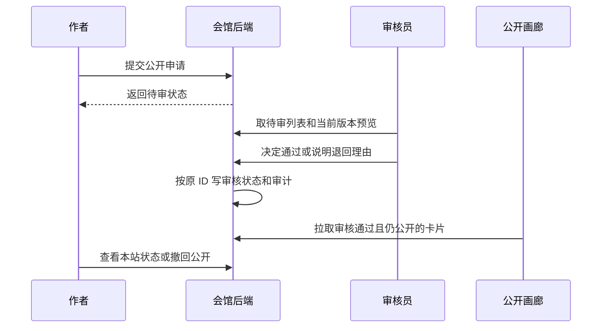

# 同人设表先审核后公开：现状与迁移评审

本说明记录现行仓库行为，并列出需要馆长确认的规则。它不是发布授权，不改变生产数据或默认可见性。现有历史与排序契约参见 [同人画廊历史与排序](FAN_GALLERY_HISTORY.md)。

## 本次审定：既有设表修改后复审

馆长已确认：同人画廊里已申请公开的关联设表，作者实质修改后必须重新审核。该稿按原卡片进入待审，即使作者本人是审核员、长老或管理员，也不得自动通过或自行审核该次修订；由另一位有审核权限的账号处理。待审时公开画廊既不显示新稿，也不以旧稿替代。保留作者的公开申请、卡片 ID、票数和现有历史，不批量重审存量，不重写既有历史。已撤回的卡片维持撤回。接口与审计见 [同人画廊历史与排序](FAN_GALLERY_HISTORY.md)。

本次只确认修改后复审，不审定首次投稿的现有例外、独立分享或其余提案；仓库合入也不等于已发布，正式启用以独立发布授权及现场验收为准。

## 状态与归属

状态为 `review_status` 与 `is_public` 的组合，避免把作者是否申请公开与审核决定混成一个字段。

| 对作者显示 | 状态 | 公开列表 |
| --- | --- | --- |
| 待审 | `is_public=1, review_status=pending` | 不显示 |
| 已公开 | `is_public=1, review_status=approved` | 按原立绘分区显示 |
| 已退回 | `is_public=1, review_status=rejected` | 不显示 |
| 未公开／撤回 | `is_public=0`，保留上次审核状态 | 不显示 |

作者通过会馆已验证账户持有记录；应用按完整作者身份（账户类型、账号标识）作用于原画廊 ID，客户端不能代填作者身份。仅现有会馆审核员、长老和管理员可决定审核；历史与管理员送回复审权限更窄。管理员送回复审仅进入待审，不等于通过。**首次投稿例外未改变：有审核权限的账号首次提交自己的设表时可自动通过；此例外不适用于上文已审定的既有设表修订。**

## 接口与操作

| 接口 | 操作者 | 读取或写入 |
| --- | --- | --- |
| `GET /api/fan/list` | 访客、登录账户 | 只返回审核通过且仍公开的记录 |
| `GET /api/fan/my` | 作者 | 只返回当前账户记录和退回理由，不提供审核者身份 |
| `POST /api/fan/submit`、`/api/fan/publish` | 作者 | 直接投稿或从本人已登记设表送审 |
| `POST /api/fan/toggle` | 作者 | 更改本人卡片公开申请，不批量更改他人记录 |
| `GET /api/fan/review/queue`、`/api/fan/review/preview` | 审核员 | 公开申请仍有效的待审记录；预览校验精确卡片 ID、版本并禁止缓存 |
| `POST /api/fan/review/decide` | 审核员 | 校验版本后通过或退回，退回理由必填 |
| `GET /api/admin/fan/history`、`POST /api/admin/fan/history/reopen` | 管理员 | 按原 ID 查看历史，有理由地送回待审，保留原记录与票数 |

## 旧数据、回滚与待批准项

- 已实现的首次迁移遵照 2026-11-06 决定：首次添加审核字段时，旧条目进入待审，原内容、公开申请、记录 ID 与点赞不被覆盖。若已有审核字段，不把历史判断批量重置。本说明不要求再次执行首次迁移。
- 可见性设计只覆盖「同人设表画廊」的查询，上传图片、已发布分享页及官方画廊各有现行路径；不能以此文档推断整个站点所有媒体都采用同样的审核状态机。
- 任何数据库/可见性变更先用合成数据练习两次应用、公开/待审/撤回记录分布及回滚；正式变更前核验能恢复的备份、保留原行和票数、不伪造旧历史。旧版若不理解审核条件，不作为会暴露待审卡的回退目标。不要用旧备份覆盖上线后产生的正常数据。
- 首次投稿的审核例外、旧数据的进一步规则及全站素材范围仍需馆长确认。本次修订规则的确认不替代生产发布授权。

隔离回归：`python -B apps/huiguan/tests/test_fan_gallery_history_http.py`、`python -B apps/huiguan/tests/test_fan_detail_preview.py`、`python -B apps/huiguan/tests/test_fan_gallery_reopen_http.py`。三套仅使用虚构内容；不能替代生产迁移和视觉验收。
